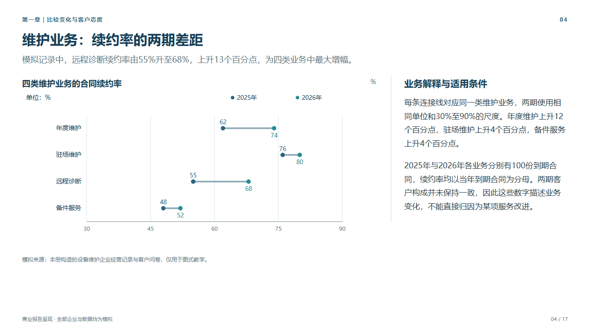
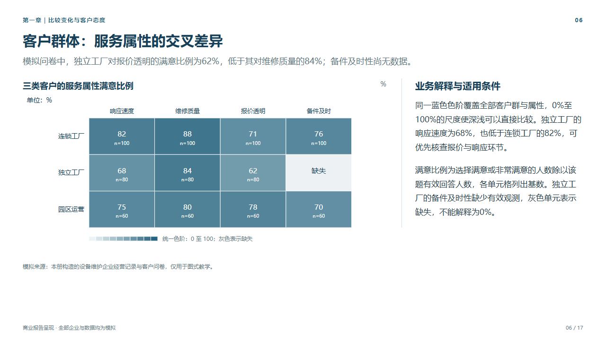
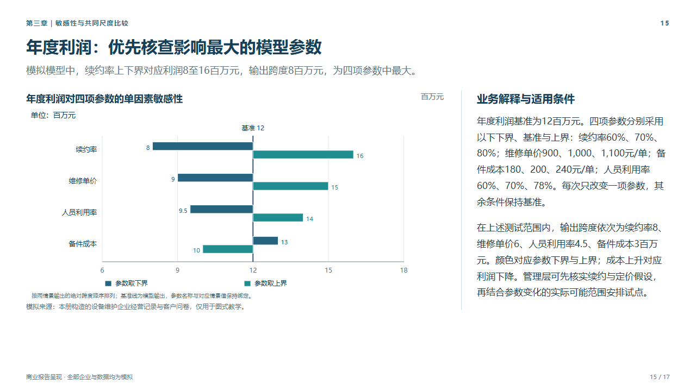
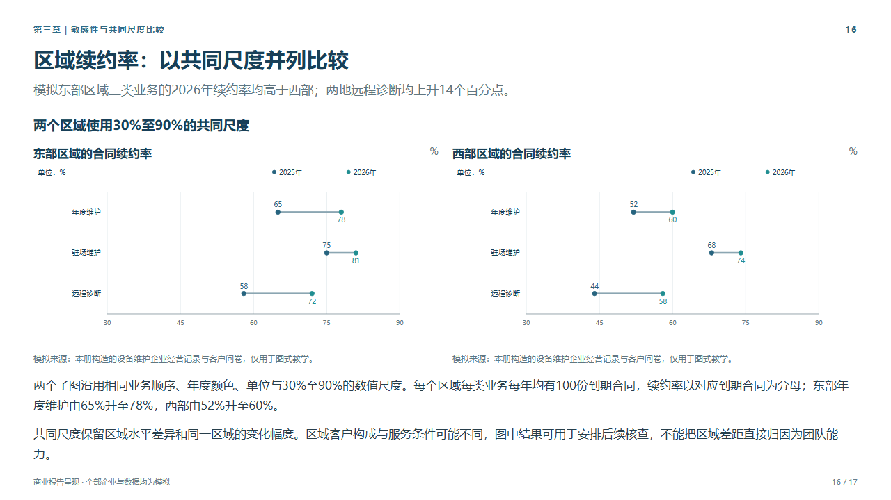

# 盒盒商业报告呈现 Skill

[](LICENSE)
[](https://agentskills.io/)
[](release-manifest.json)
[](#使用与依赖)

从研究框架、文稿或数据出发，规划合适的图表；也能将已确认内容制作成HTML、PDF或可编辑PPTX。让读者看清对象、关系和判断，同时保留完整分析。

**让图形承担解释，让正文保留分析。** 适用于商业计划书、行业与企业研究、用户研究和其他专业报告，先根据内容选择图式，再安排完整文字与版式。

<a id="release-20261116"></a>

## ✨ 2026.11.16｜从选图方案，到完整商业报告

> **先想清楚用什么图表达，再把完整分析做成报告。**

这次大更新将图表规划完整并入 `hehe-report-presentation`：既可以只为整份报告、章节、单页或一组数据设计图表方案，也可以继续制作HTML、PDF与可编辑PPT。研究框架、已有文稿、数据表和部分素材，都能作为起点。

### 新增10种分析图式，配合共同尺度的小多图

| 报告需要讲清的内容 | 新增表达方式 |
|---|---|
| 两组水平相差多少、两个时点怎样变化 | 哑铃图、斜率图 |
| 不同人群的需求与评价如何分布 | 热力矩阵、Likert态度结构图 |
| 价格、支出、处理时长集中在哪里 | 直方图、箱线图、累计分布图 |
| 估计范围多宽、预测情景怎样变化 | 点区间图、区间带 |
| 哪些参数最影响利润或估值 | 龙卷风敏感性图 |
| 多个地区、人群或品类怎样公平比较 | 使用共同尺度的小多图 |

<table>
<tr><td width="50%"><strong>两组水平与差距 · 哑铃图</strong><br></td><td width="50%"><strong>人群与需求差异 · 热力矩阵</strong><br></td></tr>
<tr><td width="50%"><strong>经营参数影响 · 敏感性图</strong><br></td><td width="50%"><strong>公平比较多个地区 · 小多图</strong><br></td></tr>
</table>

*以上均为随包教学模拟数据。可打开[17页HTML示例册](docs/report-presentation/analytical-gallery.html)、[PDF](docs/report-presentation/analytical-gallery.pdf)或[可编辑PPTX](docs/report-presentation/analytical-gallery.pptx)查看完整页面。*

### 图形解释关系，正文保留完整分析

图表方案同时交代页面作用、主要判断、选图理由、完整解释的位置、需要的数据和备选方案。制作时先做真实内容的代表页，再展开整稿；空间不足先调整布局，再按完整主题拆页，保留必要主语、因果、条件、口径与来源。

原有的产业链、付款与交付、条件分支、泳道、甘特、旅程、计算关系及基础数量图继续保留。带侧栏下拉HTML、16:9、9:16、A4翻页HTML及相应PDF，可按阅读、汇报和打印场景选择。

### 图表、图片与实际交付一起检查

本轮补强类别与数值对应、屏幕及打印图形、图片加载和PPT对象检查，修复折线、堆积标签、普通图片、嵌套SVG及负值横条的呈现问题。随包新增图表选型、经营关系、执行流程和17页分析图表教学示例，便于直接试用。

**PPT按对象提供编辑能力：** 基础数量图、斜率图、累计分布图及等宽直方图带可编辑数据；哑铃、矩阵、区间及其他复杂分析图使用可编辑形状与文字，改数时需同步几何或从页面源重建；独立SVG插图可移动替换。详细范围见[可编辑PPT说明](skills/hehe-report-presentation/references/可编辑PPT交付.md)。

**更新方法：** 替换完整 `hehe-report-presentation` 目录并新开会话。独立版和行研组合版从同一维护源导出，同名Skill只安装一份；只做规划无需安装制图或导出环境。

---

## 五种交付选择

| 形式 | 适用场景 |
|---|---|
| 带侧栏目录的下拉HTML | 长报告连续阅读，直接接收Markdown，窄屏折叠目录 |
| 16:9翻页HTML | 横向咨询汇报 |
| 9:16翻页HTML | 手机竖版阅读 |
| A4翻页HTML | 正式阅读与打印 |
| 可编辑PPTX | 由本Skill分页HTML生成原生文字、表格、图表和形状 |

各HTML形态可导出对应PDF。保留蓝白封面与章节样式，并可按报告内容选择其他阅读风格。

## 图形优先，具体怎样落地

| 报告要说明的内容 | 可以采用的视觉表达 |
|---|---|
| 资金、信息或服务在主体间流动 | 带主体和方向的关系图、流程图 |
| 不同条件对应不同选择 | 条件分支、决策树 |
| 多方分工和阶段推进 | 泳道图、时间轴、甘特图 |
| 收入、成本与利润的形成 | 瀑布图、构成图 |
| 企业或业务的数量差异 | 柱状图、条形图 |
| 需要精确查阅的数据与条款 | 表格，并附必要分析 |

每个正文页记录具体关系和图形方案。生成器检查方案是否有对应图形对象，帮助避免将普通文字卡片或表格当成关系图。制作后仍需看实际页面，检查阅读顺序、换行、信息密度和整稿节奏。

完整解释留在可见正文。空间不足时先调整图文比例和布局，再按完整主题拆页；保留数据口径、条件、来源及原稿中的分析。

## 制作流程

```text
研究框架／文稿／数据／部分素材
        ↓
确认读者与分析任务 → 规划图表、文字与数据需求
        ├─ 只做规划：交付图表方案
        └─ 规划并制作：确认完整内容与形态 → 制作代表页
        ↓
生成完整报告 → 对照原稿 → 检查实际页面 → 导出并核验PDF／PPTX
```

随包还提供 [分析图表17页示例](skills/hehe-report-presentation/assets/analytical_examples.json)、[选图示例](skills/hehe-report-presentation/assets/chart_planning_examples.json)、[经营关系示例](skills/hehe-report-presentation/assets/relationship_examples.json)、[执行流程示例](skills/hehe-report-presentation/assets/execution_examples.json)，以及 [基础对象示例](skills/hehe-report-presentation/assets/example.json)、[商业版式示例](skills/hehe-report-presentation/assets/business_layouts.json) 和 [封面与章节样式](skills/hehe-report-presentation/assets/cover_chapter.json)，方便用真实报告内容制作样张。

## 使用与依赖

将 `skills/hehe-report-presentation/` 放入客户端的 Skills 目录，新开会话。示例：

> 使用 $hehe-report-presentation 将这份Markdown报告制作成带侧栏目录的下拉HTML，保留全部正文和表格。

只交图表方案：

```text
使用 $hehe-report-presentation 为这章报告规划图表，先不制作页面。
说明每个图要讲清的关系、图式、配套解释、数据要求和缺项时的备选。
```

制作横向汇报版：

```text
使用 $hehe-report-presentation，将这份报告制作成16:9翻页HTML和PDF。
保留完整分析和来源，先识别适合图形表达的流程、结构、分支和数量关系。
使用蓝白封面与章节页，检查实际页面，并交付可修改的页面源文件。
```

制作可编辑演示文件：

```text
使用 $hehe-report-presentation，将这份已确认的逐页报告制作成可编辑PPTX。
文字、表格、图表和流程形状使用原生对象；保留完整分析。
完成实际打开、编辑、保存重开和渲染核验。
```

**安装方法：** 下载本仓库，将整个 `skills/hehe-report-presentation/` 文件夹放入客户端的 Skills 目录，保留 `scripts/`、`assets/`、`references/` 和调用配置。例如 Codex 的 `~/.codex/skills/` 或 Claude Code 的 `~/.claude/skills/`。新开会话后调用 `hehe-report-presentation`。已通过组合包安装同名Skill的用户直接更新原目录。

可独立使用，不要求安装写作或行业研究Skill。JSON转HTML只需Python标准库；Markdown直转、PDF和PPT按 [依赖清单](skills/hehe-report-presentation/依赖清单.md) 准备相应环境，不必一次安装所有依赖。

| 本次要做什么 | 需要的环境 |
|---|---|
| 只交图表规划方案 | 能读取本次材料即可 |
| JSON页面源转HTML | Python标准库 |
| Markdown直转下拉HTML | Python、markdown、beautifulsoup4 |
| 导出并检查PDF | Playwright、PyMuPDF、Chrome或Chromium |
| 生成可编辑PPTX | Playwright、python-pptx、Chrome或Chromium |
| 检查PPT的实际编辑与排版 | PowerPoint或LibreOffice，以及报告字体 |

依赖安装在实际制作报告的电脑或服务器上。接收成品的人只需要浏览器、PDF阅读器或演示软件。无需显卡或本地大模型，浏览器与办公软件可复用已有安装。

PPTX转换针对本Skill生成的分页HTML；文字、表格、图表和支持的流程形状可编辑，独立插图的编辑范围需在交付时说明。HTML阅读版同时保留。

文字需专业编辑时，可搭配 [hehe-report-writing](https://github.com/hexiaofeier/hehe-report-writing)。收到合格Markdown可直接制作下拉HTML，收到合格逐页脚本可直接制作分页报告。

## 2026-10-25 更新

首次独立公开发布，加入图形优先的页面方案与生成检查；资金流、流程、分支、结构和数值关系优先采用对应图式。保留完整分析、封面、章节和多形态交付能力。

生成 HTML 时自动检查本地 PDF 是否存在，避免出现失效下载入口；PDF 导出核验成功后自动补回链接。包外 Skill 引用纳入发布校验。

## 2026-10-24 更新

正式运行资源去除_CO文件后缀；补齐依赖不足时的替代路径，保留现有组件、封面、章节、三种分页画布、下拉目录及可编辑PPT能力。

## 校验与来源

运行 `python scripts/validate_release.py` 检查包内文件与链接。独立版和行业研究组合版从同一维护源导出，同名Skill只需安装一份。本项目采用MIT许可证。
